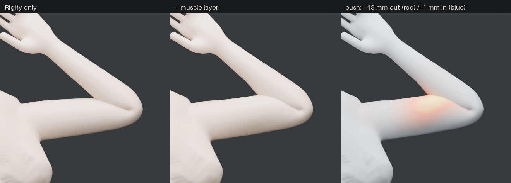
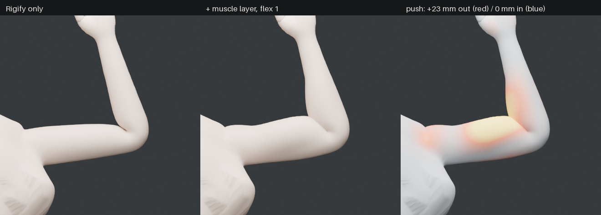
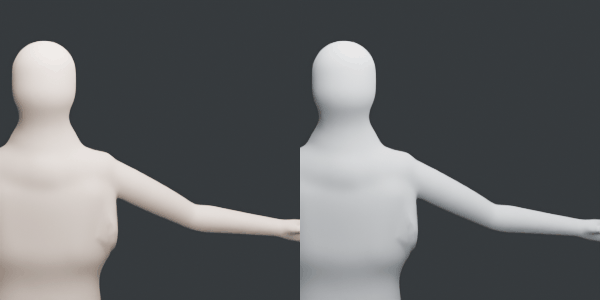

# muscle-deformation-rig-experimental

A small, **procedural muscle layer for Rigify characters** in Blender: pose-driven bulge,
a keyable "flex" slider, and jiggle on stops. It aims at about 50% realism for a small
evaluation cost. Every piece is a native Blender feature: constraints, simple-expression
drivers and Geometry Nodes. No other add-ons are needed, and the rig's own skin weights are
never modified.



*Elbow at 115°: plain Rigify (left) keeps a flat upper arm. The muscle layer (middle) raises
a biceps peak of up to +13 mm, purely from the pose. Right: signed push (red = out, blue = in).*

| Flex slider (isometric tension) | Jiggle on a quick arm raise |
|---|---|
|  |  |

More: [shoulder raise](docs/images/shoulder_raise.png) ·
[arm bent forward](docs/images/arm_bent_side.png) · [wrist curl](docs/images/wrist_curl.png) ·
[thumb across palm](docs/images/thumb_in.png) · [jiggle key frames](docs/images/jiggle_strip.png)

**Research write-up, design decisions and measurements:** [docs/research.md](docs/research.md)

## How it works (one paragraph)

Each muscle is a hidden bone from its origin to its insertion, with a **Stretch To**
constraint that preserves volume. When the joint bends and the line shortens, the bone's X/Z
scale grows; when the line stretches, it shrinks. A driver turns that scale (plus the flex
slider) into a push distance. A **Geometry Nodes** modifier after the Armature modifier
pushes the skin along its normal, inside a soft per-muscle mask. A second Geometry Nodes
modifier runs a per-vertex **damped spring** in a Simulation Zone, so masked flesh overshoots
and settles when the limb starts or stops.

## Requirements

* Blender **4.2+**. Tested on **4.5.14 LTS** and **5.0.1**.
* A rig generated by **Rigify** from the stock *Human* metarig, or one whose bone names
  match (`ORG-upper_arm.L`, `DEF-forearm.L.001`, …).
* A body mesh bound to that rig with an Armature modifier and normal DEF-bone weights.

## Install

**Blender 4.2+ (extension):** build the zip with Blender's own tool, then use
*Edit → Preferences → Get Extensions → ⌄ → Install from Disk*:

```bash
blender --command extension build --source-dir muscle_rig --output-dir dist
```

**Legacy add-on:** zip the `muscle_rig/` folder (the folder itself, not just its contents)
and install it through *Preferences → Add-ons → ⌄ → Install from Disk*.

## Use

1. Generate your Rigify rig as usual and bind the mesh to it.
2. Select the rig (or the mesh) and open **3D Viewport → Sidebar (N) → Muscle**.
3. Pick the sets (**Arm**, **Chest**, **Hand**, **Face** (experimental)) and press
   **Build Muscles**.
4. Optional: press **Rebuild on Re-Generate**. The muscles then come back automatically
   every time you press Rigify's *Re-Generate Rig*.
5. Animate. The **Flex** sliders (`muscle_flex_arm.L`, …) live on the arm's
   `upper_arm_parent` bone, `torso` and `jaw_master`, so they key like any Rigify property.
6. Before rendering or scrubbing backwards, bake the jiggle: *Physics tab → Simulation Nodes → Bake*.

From Python (for example in a Rigify finalize script):

```python
from muscle_rig import api
built, painted = api.apply(rig, ("arm", "chest", "hand"))   # build + paint + bind
api.rebind(rig)          # after hand-repainting the MUS-* vertex groups
api.strip(rig)           # remove everything again
```

### Tuning

| Want | Change |
|---|---|
| Bigger or smaller bulge everywhere | *MUS Bulge* modifier → **Strength** |
| One muscle stronger | `bulge` / `bulge_max` / `push` for that muscle in `muscle_rig/library.py` |
| Bulge in a different place | repaint the `MUS-<muscle>.<side>` vertex group, then `api.rebind(rig)` |
| Floppier or stiffer flesh | *MUS Jiggle* → **Frequency** (Hz) and **Damping** (0 = wobbles forever, 1 = no overshoot) |
| See the jiggle | *MUS Jiggle* → **Debug Output** writes `mus_jiggle_lag` (view it as an attribute) |

## Test, render, benchmark

Everything runs headless with either Blender or the `bpy` pip module
(`pip install bpy==4.5.*` needs Python 3.11):

```bash
python tests/test_muscle_rig.py --perf                # 21 tests, exit code = failures
blender -b --factory-startup -P tests/test_muscle_rig.py
python scripts/render_compare.py --out docs/images    # comparison sheets (Cycles CPU)
python scripts/render_jiggle.py --out docs/images     # jiggle GIF + strip + lag CSV
python scripts/benchmark.py                           # cost table, see docs/research.md §4
python scripts/demo_scene.py --out demo.blend         # the test scene, to open in Blender
```

The demo scene is the stock Rigify human plus a procedural mannequin: metaball torso, tube
limbs, voxel-remeshed. It exists only to test the layer; use your own character for looks.

## Repository layout

```
muscle_rig/          the add-on (also a Blender 4.2+ extension)
  library.py         muscle definitions (arm, chest, hand, face): edit to tune
  build.py           sensor bones + flex properties on the rig
  weights.py         procedural masks + compact bake
  bulge.py           Geometry Nodes push + drivers
  jiggle.py          Geometry Nodes simulation-zone spring
  api.py / ui.py     one-call API, Rigify regenerate hook, sidebar panel
scripts/             demo scene, renders, benchmark
tests/               headless test suite
docs/                research write-up + images
development_note/    work log and architecture notes
```

## Status and limits

A prototype: arm, chest and hand work and are tested; the face set is experimental. The
push is along the normal only (no sliding, no collision), and placements are tuned on the
stock metarig's A-pose. It does not export to game engines as-is. Details and the reasoning
are in [docs/research.md §6](docs/research.md#6-limitations-known-not-hidden).
